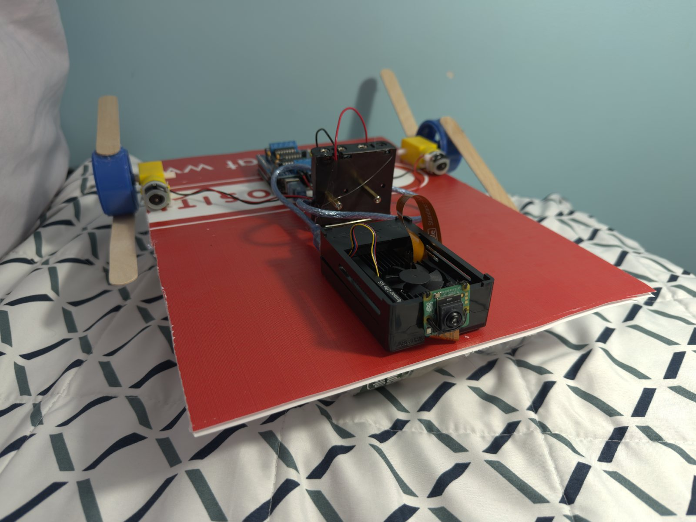
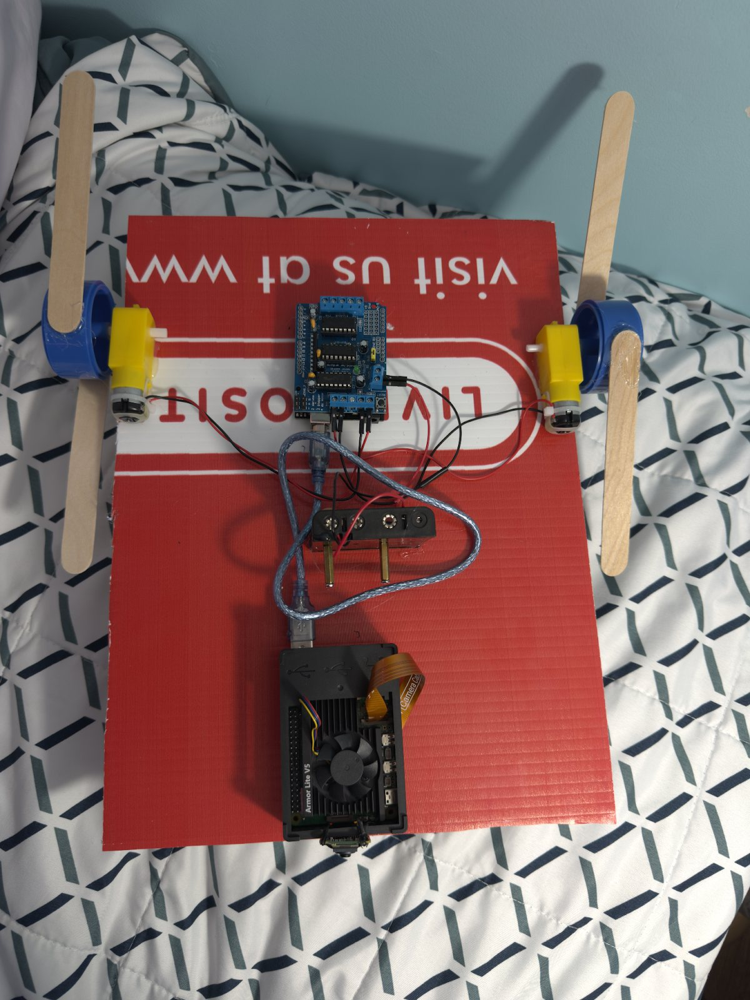
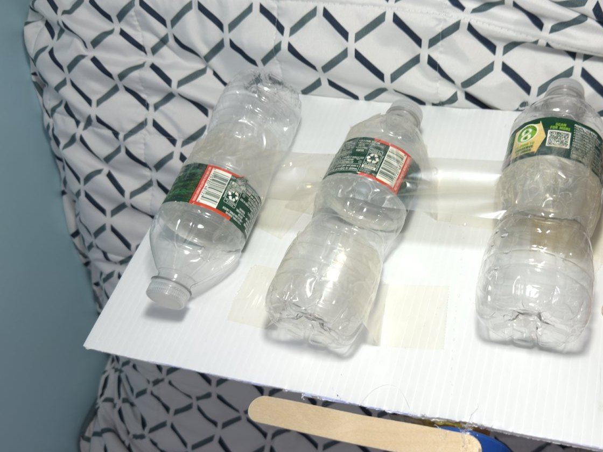

# AI trash-cleaning robot boat

A small autonomous boat, built for about $250, that uses on-device object detection to
find floating trash (bottles and cups) and steer itself to it. I built it in 10 days in
February 2026 for the science fair. It advanced to the state science fair.

The boat detects and reaches trash. It does not collect it; that was outside the scope.

Full write-up: https://daivikpatel9.github.io/daivikpatel9/projects/trash-cleaning-robot.html



## How it works

```
AI camera (IMX500) -> Raspberry Pi 5 -> USB serial -> Arduino Uno -> 2 motors
```

- The **Raspberry Pi AI Camera** runs the stock MobileNet-SSD detection model on its
  Sony IMX500 sensor. No cloud and no internet connection are needed.
- **`code/boat_ai.py`** runs on the Raspberry Pi 5. It starts `rpicam-hello` (the Pi's
  camera app) with the MobileNet-SSD post-process file, reads its verbose log, and pulls
  the label, confidence, x position and box width out of each detection line with a
  regular expression. It then decides on a command:
  - ignore anything labelled `person`, so the boat never steers at people
  - ignore detections with confidence at or below 0.5
  - box wider than 850 px means the object is too close: stop (highest priority)
  - x below 400 turns left, x above 812 turns right, anything in between goes forward
  - stop if no target has been seen for 0.8 seconds
  - only send a command when the state changes
- **`code/boat_motor_controller.ino`** runs on the Arduino Uno. It reads single-character
  commands at 9600 baud (`f` forward, `l` left, `r` right, `s` stop) and drives the two
  motors through an L293D motor shield. It turns by stopping one side.

The Pi decides and the Arduino drives. That split keeps motor current away from the Pi.

## Hardware

| Part | Notes |
|---|---|
| Raspberry Pi 5 (2 GB) | With active cooler, in a case |
| Raspberry Pi AI Camera (Sony IMX500) | Runs the detection model on the sensor |
| Arduino Uno + L293D motor shield | Drives the motors |
| 2 TT gear motors | With homemade paddle wheels from old tires and popsicle sticks |
| Hull | Corrugated plastic board on three empty water bottles |
| Power | AA batteries for the motors; the Pi is powered over a USB cable (tethered) |

Total cost: about $250.

| Top view | Underside |
|---|---|
|  |  |

## Running it

### Arduino

1. Open `code/boat_motor_controller.ino` in the Arduino IDE.
2. Install the motor shield library that provides `AFMotor_R4.h`.
3. Plug the left motor into motor port 1 and the right motor into port 2, then upload.
4. To test without the Pi, open the Serial Monitor at 9600 baud and send `f`, `l`, `r` or `s`.

### Raspberry Pi

1. Use Raspberry Pi OS with the AI Camera connected and its IMX500 model files installed,
   so `/usr/share/rpi-camera-assets/imx500_mobilenet_ssd.json` exists.
2. Install pyserial: `pip install pyserial`.
3. Connect the Arduino over USB. The script expects it at `/dev/ttyACM0`.
4. Run `python3 code/boat_ai.py`. Press Ctrl+C to stop; the script sends a stop command
   before it exits.

The thresholds (`LEFT_LIMIT`, `RIGHT_LIMIT`, `MAX_WIDTH`, `STOP_DELAY`) are at the top
of the script.

**Note on the code:** both files were transcribed from the project notebook, not copied
from the original devices. The notebook lost the Python indentation, so the block
structure of `boat_ai.py` was rebuilt from the logic.

## Results

Nearly 60 controlled trials in a bathtub, with bottles and cups in different orientations.

| Object orientation | Reached |
|---|---|
| Upright | 100% |
| Cup rim facing the boat (cups only) | 100% |
| Upside down | 61.5% |
| Diagonal | 38.5% |
| On its side | 33.3% |
| Overall | about 64% |

Power: about 15 W typical, under 27 W peak.

More detail and the charts are in [docs/RESULTS.md](docs/RESULTS.md).

## Limitations

- **Stock model.** I tried a YOLOv8 trash model first, but converting it to the IMX500
  format failed, so the boat uses the stock MobileNet-SSD that ships with the camera.
  It is not custom trained, and its training data is mostly upright objects. That is
  why objects on their side or at an angle were often missed.
- **Tethered power.** The Pi runs on a USB power cable. The cable pulled the boat to the
  left; the steering loop corrected for it.
- **No collector.** The boat reaches trash but does not pick it up.
- **Bathtub testing.** Trials ran in a bathtub with a colored board so clear objects
  show against the white tub.
- **Distance by box width.** There are no distance sensors. The boat stops when the
  detection box is wider than 850 px.
