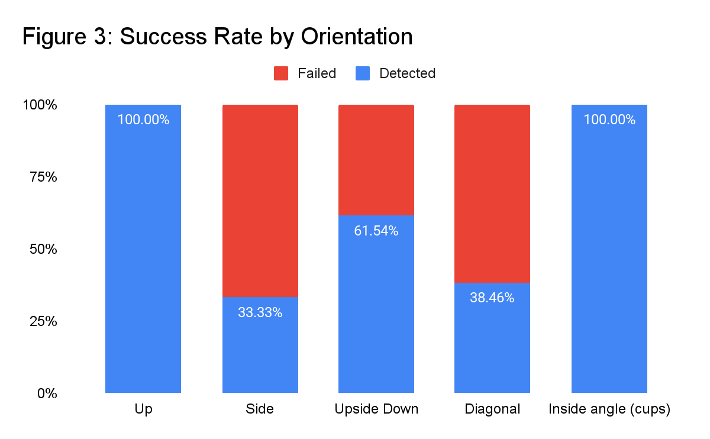
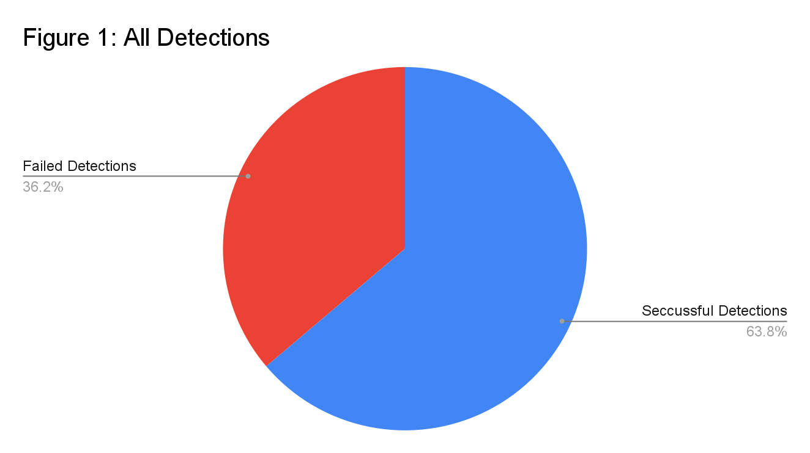
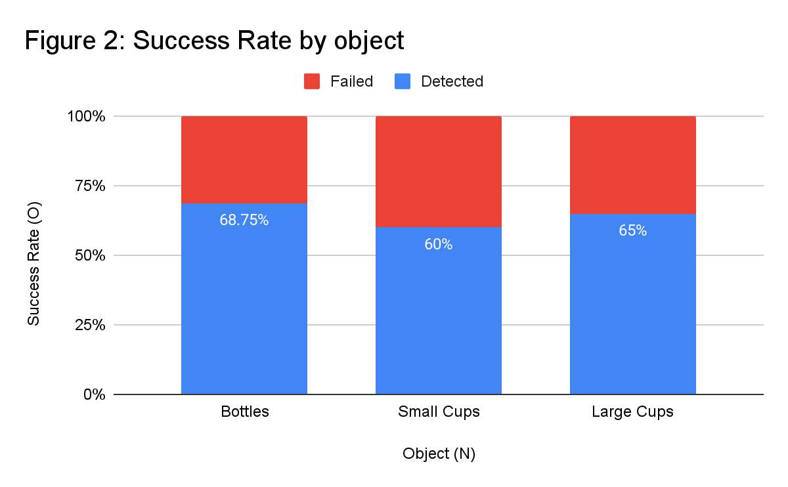

# Results

The boat was tested in a bathtub across nearly 60 controlled trials, using plastic
bottles and cups placed in different orientations. A trial counted as a success when
the boat detected the object and reached it. A colored board was placed in the tub so
clear objects show against the white surface.

The detection model is the stock MobileNet-SSD that ships with the Raspberry Pi AI
Camera. It was not custom trained.

## Success by orientation

| Object orientation | Reached |
|---|---|
| Upright | 100% |
| Cup rim facing the boat (cups only) | 100% |
| Upside down | 61.5% |
| Diagonal | 38.5% |
| On its side | 33.3% |
| Overall | about 64% |

## Power

About 15 W in typical running, under 27 W at peak.

## Conclusion

A low-cost AI boat can find and reach floating trash, so the approach is feasible. It is
limited by the model's training data, which is mostly upright objects. Objects lying on
their side or at a diagonal were missed most often. A model trained on trash in many
orientations is the next step.
